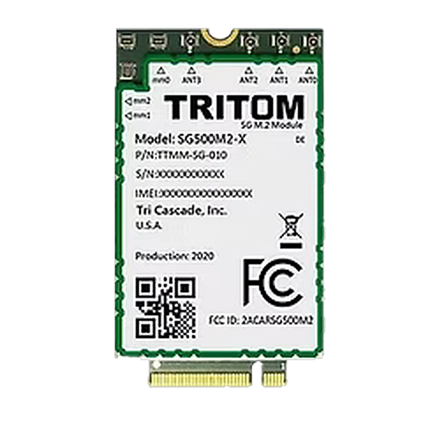
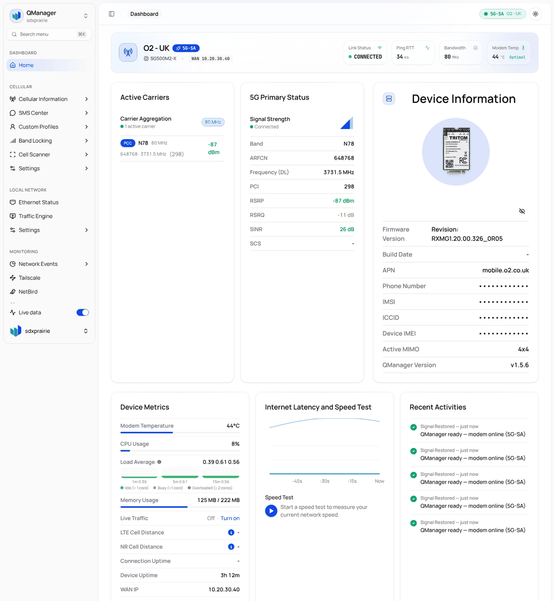
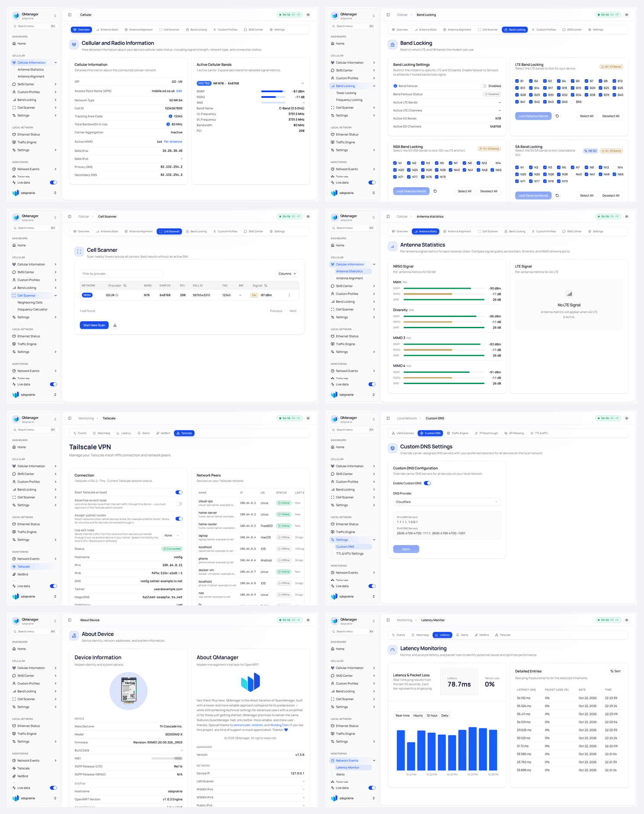

# QManager for the VOS 5G / TRITOM SG500M2-X

<div align="center">
  
  <h3>A modern web UI that runs on the modem itself, for the Tri Cascade VOS 5G USB dongle and the TRITOM SG500M2-X module (Compal RXM-G1, Snapdragon X55)</h3>

  
  -purple?style=flat-square)
  
  
  
</div>

---

<div align="center">
  
</div>

<details>
<summary><b>More pages: Cellular Information, Band Locking, Cell Scanner, Antenna Statistics, Tailscale, Custom DNS, About Device, Latency</b></summary>
<br/>
<div align="center">
  
</div>
</details>

<sub>Screenshots are from a real VOS 5G on O2 UK. Identifiers (IMEI, ICCID, IMSI, cell IDs, IP addresses, Tailscale names) have been replaced with placeholders.</sub>

---

## What this is

[QManager-GO](https://github.com/evairo176/qmanager) is a polished web interface (Next.js front end embedded in a single Go binary) for **Quectel** modems. It reads everything through Quectel AT commands, which the VOS 5G doesn't have: its Compal firmware speaks a different dialect (`cricli`, `AT+BINFO`, `AT+BNRINFO`, …).

This fork keeps evairo176's UI and makes it work on the VOS 5G:

* **The modem is reached through `qcmd`.** `qcmd` is a small translator from the companion repo, [vos5g-sdx55](https://github.com/thalatamsainath/vos5g-sdx55). It answers QManager's Quectel AT commands using Compal's `cricli`, `atcli` and QMI. QManager never falls back to fake data: if the modem can't answer, the page shows nothing.
* **It runs from `/data`.** The VOS root filesystem is read-only, so QManager is started by **vosclean**, the reversible hardening package from the same repo. vosclean also provides key-only SSH, a firewall on the cellular side, a blocked vendor update client and custom DNS.
* **Pages that were placeholders upstream now work on this modem:** Tailscale, custom DNS, the cell scanner, About Device, the System Health Check (34 checks plus a redacted support bundle) and the speed test (real speedtest.net servers; it runs on the modem's single CPU core, so expect at most about 100 Mbps).
* **Web console** (System Settings → Web Console): a root shell in the browser, served natively by QManager (no ttyd). Off by default, needs a logged-in session, closes on logout, after 30 idle minutes, or when switched off.

The full upstream history is kept, with the VOS changes as separate commits on top (`git log 2cc6795e..`, see [Following upstream](#following-upstream)).

## What works

| Area | On the VOS 5G |
|---|---|
| Dashboard | Operator, network type, signal (RSRP/RSRQ/SINR), per-carrier details, temperatures, CPU and memory, live traffic, latency and RTT, recent events, connection uptime |
| Cellular Information | Cell ID, TAC, PCI, ARFCN, band and bandwidth, carrier aggregation, APN, WAN IP, carrier DNS, LTE cell distance (timing advance) |
| Antenna statistics / alignment | Per-receive-chain RSRP/RSRQ/SINR (4×4 on n78) |
| Band locking | LTE, NR5G-NSA and NR5G-SA band masks, plus restore to factory |
| Tower / frequency locking | LTE cell lock, 5G SA cell lock, 5G ARFCN lock |
| Cell scanner | Serving cell plus LTE neighbours of your carrier (read over QMI), frequency calculator |
| Connection scenarios | Network mode (Auto, LTE only, 5G only, LTE+5G) and band sets in one click |
| APN | View and change |
| SMS | Inbox, send, delete. On 5G SA, sending switches to LTE and back automatically |
| Custom DNS | Applied for real: the modem's dnsmasq queries are redirected to your resolvers |
| Tailscale | Install (Official download or 15 MB "Tiny" build), log in, start on boot, accept subnet routes, use or advertise an exit node |
| NetBird | Install the official build, connect with a setup key, start on boot |
| WireGuard | Connect to any WireGuard VPN: upload, paste or enter configs, edit and delete them; kernel or userspace engine, LAN-only or LAN + stick, kill switch, the config's DNS. 65 Mbit/s through a commercial VPN with the kernel engine |
| System | Bandwidth monitor, system logs, System Health Check with a redacted support bundle, web console, extra kernel modules, AT terminal (IMEI writes, factory reset and USB-mode changes blocked), speed test |

## What's hidden (and why)

Pages and controls that would do nothing on this modem are hidden rather than left looking usable. The list, with the reason for each, is in [`src/constants/vos-features.ts`](src/constants/vos-features.ts); deleting an entry brings it back once it works.

| Hidden | Why |
|---|---|
| Traffic Engine, DPI masking, TTL | User traffic takes the IPA hardware fast path and never reaches Linux, so `nfqws` and TTL rules can't see it |
| IP passthrough, LAN address editor, Ethernet status | Stubs upstream; the VOS has no Ethernet port |
| Custom SIM profiles | Applying a profile doesn't change the modem yet (Connection Scenarios do) |
| Cellular → Settings (SIM slot, radio power, 5G architecture, roaming), network priority, MBN | Not wired to the modem, or no Compal equivalent |
| IMEI editing, FPLMN | Deliberately blocked SIM/NV writes |
| Alerts, SMS forwarding, watchdog recovery | Settings are saved, but no daemon acts on them here (vosclean handles modem crashes) |
| Band and tower-lock failover, tower-lock schedule, LTE EARFCN-only lock | No watcher daemon; the modem only locks LTE to a cell |
| General settings, languages, backup/restore, connection quality, adaptive polling | Not saved or not applied on this build |
| Self-update | An upstream update would replace this build |
| Second SIM, NR-DC / mmWave | Not in the hardware |

## Install

You need a VOS 5G (or an SG500M2-X on a USB adapter) on firmware `RXMG1.20.00.326.73` (v73), and a Mac or Linux PC.

1. **Back up first.** Follow the backup guide in [vos5g-sdx55](https://github.com/thalatamsainath/vos5g-sdx55/blob/main/docs/03-backup.md): a QCN through QPST, plus UBI volume images. **Never read the `efs2` partition from Linux, because it resets the modem.**
2. **Get the binaries.**
   * **From [Releases](../../releases):** `qmanager-core-armv7` and `tailscaled-tiny-armv7`, with `SHA256SUMS.txt`.
   * **Or build them yourself:** see [Building](#building).
   * **`qcmd`:** build it with `./qcmd/build.sh` in vos5g-sdx55.
3. **Install with vos5g-sdx55's installer**, which sets up vosclean, qcmd and QManager over SSH:
   ```bash
   git clone https://github.com/thalatamsainath/vos5g-sdx55 && cd vos5g-sdx55
   ./install.sh --check
   ./install.sh --pubkey ~/.ssh/id_ed25519.pub \
                --qmanager /path/to/qmanager-core-armv7 --qcmd dist/qcmd-armv7 \
                --tailscale-tiny /path/to/tailscaled-tiny-armv7      # optional
   ssh -t root@192.168.225.1 /data/vosclean/bin/vosclean qmpass     # set the QManager password
   ```
4. Open **http://192.168.225.1:8080**, or **https://192.168.225.1:8443** (self-signed certificate). The stock web UI stays on ports 80/443.

To update QManager later, re-run `install.sh` with the new binary; it keeps your settings. To remove everything, run `ssh root@192.168.225.1 /data/vosclean/bin/uninstall.sh`.

### Power

The stick draws a lot under 5G load. Powered from a router's USB port (tested on a GL.iNet GL-MT1300), it reset every few minutes. With a separate power feed (a powered hub or a USB power injector) it was completely stable.

## How it fits together

```
 browser ──HTTP──▶ qmanager-core (this repo, Go + embedded UI, /data/vosclean/qm)
                        │  "AT+QENG=\"servingcell\"", "AT+QCAINFO", "AT+QNWPREFCFG=…"
                        ▼
                     qcmd ──▶ cricli (Compal radio CLI)        ┐
                          ──▶ atcli  (AT+BINFO / AT+BNRINFO …) ├─▶ SDX55 modem
                          ──▶ QMI over QRTR (cell scan)         ┘
 vosclean (boot hook in /oem) starts QManager, tailscaled and the WireGuard
 tunnel (vos-wg), and owns the firewall, SSH, DNS DNAT and Tailscale NAT rules
```

Files on the modem:

| Path | What |
|---|---|
| `/data/vosclean/qm/bin/qmanager-core` | This binary |
| `/data/vosclean/qm/bin/qcmd` | AT translator |
| `/data/vosclean/qm/etc/` | QManager settings: auth, sessions, TLS certs, profiles, DNS, … |
| `/data/vosclean/tailscale/` | Tailscale binaries and state |
| `/data/vosclean/wireguard/` | WireGuard configs (root only) and the active one |
| `/data/vosclean/log/qmanager.log` | QManager output |
| `/data/vosclean/log/qm-requests.log` | Every state-changing request (method, path, client; no bodies) |
| `/data/vosclean/log/qcmd-writes.log` | Every state-changing AT/cricli command |

### Environment variables

Set by vosclean when it starts QManager; change them in `/data/vosclean/etc/vosclean.conf`.

| Variable | vosclean default | Meaning |
|---|---|---|
| `PORT` | `8080` | HTTP port |
| `TLS_PORT` | `8443` | HTTPS port (self-signed certificate, generated on first start) |
| `TLS_ENABLED` | `true` | `false` turns HTTPS off |
| `QM_WATCHDOG` | `0` | `1` lets the connection watchdog toggle the radio and reboot the modem when pings fail. Leave it off: on this modem it caused reboot loops |
| `WEB_ROOT` | *(embedded)* | Serve the UI from a directory instead of the embedded copy |

## Building

Requirements: Node.js 20+ (or Bun) and Go 1.24+.

```bash
npm ci
npx next build                                   # static export -> out/
rm -rf backend/web/out && mkdir -p backend/web/out && cp -r out/. backend/web/out/
cd backend
go test ./...
CGO_ENABLED=0 GOOS=linux GOARCH=arm GOARM=7 \
  go build -trimpath -ldflags="-s -w" -o ../dist/qmanager-core-armv7 ./cmd/server
```

**CI:** the **VOS release** workflow (`.github/workflows/vos-release.yml`) does the same on GitHub. It also builds **Tailscale Tiny** from Tailscale's own source: a single 15 MB binary, byte-for-byte reproducible. Run it from the Actions tab to get the binaries as artifacts, or publish a release with a tag like `vos-v1.0.0` to have them attached to it.

## Following upstream

```bash
git remote add evairo176   https://github.com/evairo176/qmanager.git      # base and UI (branch dev-go)
git remote add latifangren https://github.com/latifangren/QManager-GO.git  # source of individual features
git fetch evairo176
git log --oneline 2cc6795e..                                               # the VOS changes
git merge evairo176/dev-go                                                 # take upstream updates
```

The fork starts from evairo176 `dev-go` at `2cc6795e`. Each VOS change is its own commit with an explanation, so it's clear what to re-check after a merge. The upstream README (written for Quectel modems) is kept at [docs/UPSTREAM-README.md](docs/UPSTREAM-README.md).

## Security notes

* **Set a QManager password straight after installing** (`vosclean qmpass`). Until you do, QManager accepts `admin`.
* **Only the USB side can reach the stick.** vosclean drops new connections arriving from the cellular network, so QManager and SSH can't be reached from the internet. With Tailscale running, they can also be reached from your tailnet.
* **Reboots are deliberate.** The connection watchdog's reboots are off unless `QM_WATCHDOG=1`, and QManager's Reboot button is logged in `qm-requests.log`.

## Credits and licence

* **QManager:** by [DrDolomite](https://github.com/dr-dolomite/QManager).
* **QManager-GO:** by [evairo176](https://github.com/evairo176/qmanager), whose UI this fork uses, and [latifangren](https://github.com/latifangren/QManager-GO).
* **Device information:** USB modes, bootloader state and QCN backups were worked out by the [eko.one.pl VOS 5G thread](https://eko.one.pl/forum/viewtopic.php?id=25031).

The licence is **MIT with Commons Clause** (see [LICENSE](LICENSE)): you may use, modify and share it, but not sell it.

This project isn't affiliated with Tri Cascade, Compal, Quectel or Qualcomm. Product names are used only to identify the hardware. Modifying your device is at your own risk.
